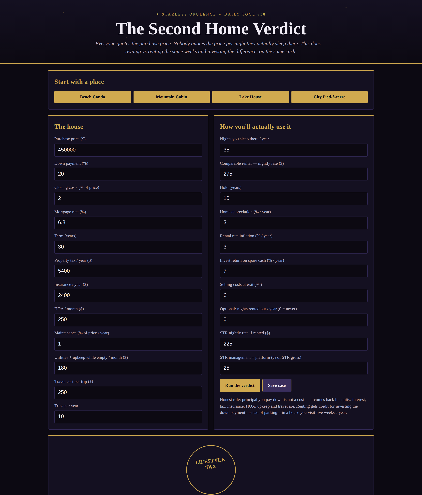

# The Second Home Verdict

**Live:** https://thebullbrew.github.io/second-home-verdict/
**Repo:** https://github.com/thebullbrew/second-home-verdict

## What it does

Everyone quotes the purchase price of a second home. Nobody quotes the price per night they actually sleep there. This tool does — owning vs renting the same weeks and investing the difference, on the same cash.

Enter the house, its carrying costs, travel to get there, and how many nights a year you'll honestly use it. It simulates the mortgage month by month, totals interest, tax, insurance, HOA, maintenance, empty-house utilities and travel, credits any short-term rental income, and recovers your equity at sale after appreciation and selling costs. The renting path pays the comparable nightly rate for exactly those nights and invests the down payment instead.

Verdicts: **OWN IT / RENT THE WEEKS / CLOSE CALL / LIFESTYLE TAX** — the last fires when your true cost per night is more than double the rental rate. Plus a break-even nights solver, cost anatomy, a nights-used sensitivity table, saveable cases, and a copy summary.

## The method

Principal paid down is not a cost — it returns as equity. Interest and carrying costs are gone forever. A house used 35 nights a year can easily cost $600–$900 per night slept there once you count the other 330 days of tax, insurance, HOA and upkeep. Renting isn't "throwing money away" when the alternative is throwing it away 330 days at a time.

## How to run

Open `docs/index.html` in any browser, or visit the live link above. Works offline as a PWA. No backend, no accounts, all math in your browser.

Dark aesthetic variation 20 — Starless Opulence.
